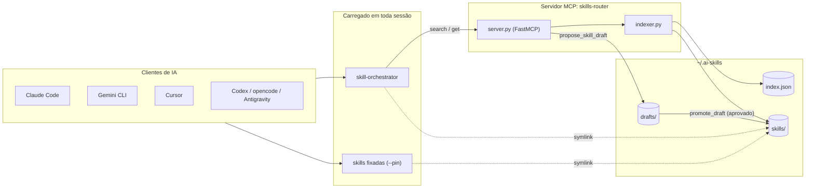
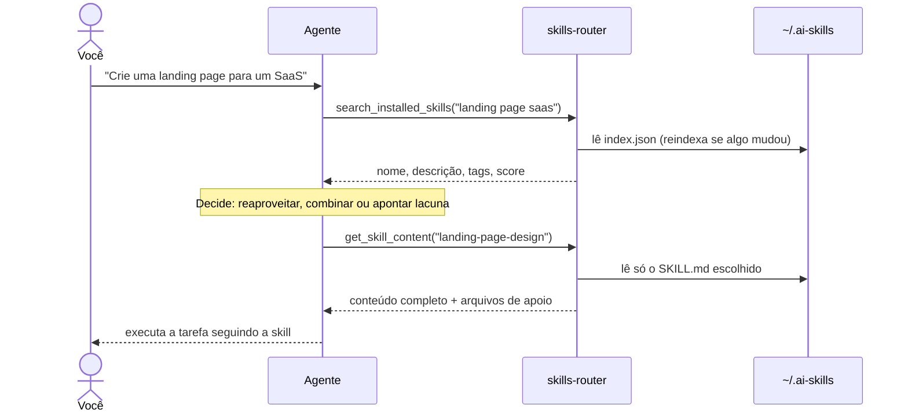

<div align="center">
  <picture>
    <source media="(prefers-color-scheme: dark)" srcset="docs/assets/hero-dark.svg" />
    <source media="(prefers-color-scheme: light)" srcset="docs/assets/hero-light.svg" />
    
  </picture>

  <br />

  
  
  
  
  

  <p align="center">
    <strong>MCP Server + Meta-Skill de roteamento de skills: seu agente encontra a skill certa entre centenas, sem carregar todas no contexto.</strong>
  </p>

  <p align="center">
    <a href="#visão-geral">Visão geral</a> •
    <a href="#arquitetura-e-fluxo">Arquitetura</a> •
    <a href="#início-rápido">Início rápido</a> •
    <a href="#tools-do-servidor-mcp">Tools MCP</a> •
    <a href="#meta-skill-skill-orchestrator">Meta-skill</a> •
    <a href="#skills-incluídas">Skills incluídas</a> •
    <a href="#segurança">Segurança</a> •
    <a href="#privacidade">Privacidade</a> •
    <a href="#licença">Licença</a>
  </p>
</div>

---

## Visão geral

Quem acumula dezenas ou centenas de skills paga por isso em toda sessão: cada cliente
(Claude Code, Gemini CLI, Cursor...) carrega a descrição de **todas** elas no contexto,
use ou não.

Este projeto troca esse custo fixo por uma busca. As skills saem das pastas dos clientes e
vão para uma fonte única; o agente passa a enxergar nativamente só um orquestrador e as
skills que você fixar, e busca o resto quando precisa.

<table>
  <tr>
    <td width="33%" valign="top">
      <h3>🔎 Busca por relevância</h3>
      Ranking leve sobre nome, tags e descrição. A resposta traz só metadados resumidos e
      um score, nunca o arquivo inteiro.
    </td>
    <td width="33%" valign="top">
      <h3>📦 Carga sob demanda</h3>
      O <code>SKILL.md</code> completo só entra no contexto depois de escolhido, junto com
      a lista de arquivos de apoio da skill.
    </td>
    <td width="33%" valign="top">
      <h3>♻️ Índice que se cuida</h3>
      Na subida do servidor e a cada busca, os arquivos são comparados; a reindexação só
      roda se algum <code>SKILL.md</code> mudou.
    </td>
  </tr>
  <tr>
    <td width="33%" valign="top">
      <h3>🧭 Gatekeeping</h3>
      A meta-skill impõe a ordem: reaproveitar, depois combinar, e só então apontar a
      lacuna. Nada de skill nova para cada tarefa.
    </td>
    <td width="33%" valign="top">
      <h3>🙋 Aprovação humana</h3>
      Skills novas nascem como rascunho em quarentena e só são promovidas com duas
      confirmações explícitas.
    </td>
    <td width="33%" valign="top">
      <h3>🛟 Instalação reversível</h3>
      Um comando migra tudo com backup e manifesto. Outro comando devolve cada arquivo ao
      lugar de origem.
    </td>
  </tr>
</table>

## Arquitetura e fluxo

São duas peças: a **meta-skill** diz ao agente quando e como buscar; o **servidor MCP**
executa a busca e entrega o conteúdo.



O que acontece numa tarefa comum:



## Início rápido

Requer [uv](https://docs.astral.sh/uv/) (traz o `uvx`), `git` e Python 3.10+. Linux ou macOS.

**Sem instalar nada (zero-config, via `uvx`).** Fixe um commit (SHA completo, 40 caracteres):
o servidor passa a subir offline a partir do cache, e o código só muda quando você trocar o pin.

```bash
SHA=$(git ls-remote https://github.com/DyoneNunes/mcp-manage-router-skill HEAD | cut -f1)
URL="git+https://github.com/DyoneNunes/mcp-manage-router-skill@$SHA"

uvx --from "$URL" skills-router init --dry-run --server-command "$(command -v uvx) --from $URL skills-router serve"
uvx --from "$URL" skills-router init           --server-command "$(command -v uvx) --from $URL skills-router serve"
```

O `--server-command` é obrigatório nesse modo: sem ele, o `init` registraria o caminho
temporário do cache do uv, que quebra quando o cache é limpo.

**A partir de um clone** (para ler ou editar o código):

```bash
git clone https://github.com/DyoneNunes/mcp-manage-router-skill.git
cd mcp-manage-router-skill

uv run skills-router init --dry-run   # mostra o que seria feito, sem alterar nada
uv run skills-router init             # executa
```

Depois, reinicie os clientes para carregarem o servidor MCP, a ativação automática e a nova
lista de skills.

> [!NOTE]
> **Ativação automática.** Uma skill é só uma descrição que o modelo pode ignorar: em testes
> com o Claude Code, o orquestrador sozinho quase nunca fazia o agente buscar. Por isso o
> `init` também instala um hook `UserPromptSubmit` no Claude Code (`~/.claude/settings.json`)
> e um bloco de regra nos arquivos globais do Gemini CLI/Antigravity (`~/.gemini/GEMINI.md`),
> Codex (`~/.codex/AGENTS.md`) e opencode (`~/.config/opencode/AGENTS.md`). Com o hook, o
> agente buscou e carregou a skill certa em 4 de 4 pedidos de desenvolvimento. Cursor e Claude Desktop pedem um passo manual
> (veja a skill `skills-router-mcp`). Use `--no-activation` para pular; o `restore` remove tudo.

> [!IMPORTANT]
> O `init` **move** as skills que já existem nas pastas dos seus clientes. Nada é apagado:
> os originais vão para `~/.ai-skills/backups/<data>/` com um manifesto, e
> `skills-router restore` desfaz tudo. Rode o `--dry-run` antes.

Para manter algumas skills nativas (aparecendo no menu `/` do cliente), fixe-as:

```bash
uv run skills-router init --pin minha-skill --pin outra-skill
```

<details>
<summary><strong>📋 O que o <code>init</code> faz, passo a passo (clique para expandir)</strong></summary>

1. Cria `~/.ai-skills/skills` e `~/.ai-skills/drafts`.
2. Instala a meta-skill em `~/.ai-skills/skills/skill-orchestrator/SKILL.md`.
3. Detecta os clientes instalados e **importa** as skills que eles já têm para a fonte
   única. Skills idênticas em vários clientes são importadas uma vez só.
4. Move os originais para `~/.ai-skills/backups/<data>/`, com manifesto.
5. Deixa na pasta de skills de cada cliente apenas symlinks para o orquestrador e para as
   skills fixadas.
6. Registra o servidor MCP `skills-router` na config global de cada cliente, com cópia de
   segurança do arquivo antes de editar.
7. Configura a ativação automática (hook no Claude Code, bloco de regra gerenciado nos
   demais), sem tocar no resto dos arquivos.
8. Instala as [skills incluídas](#skills-incluídas) que você ainda não tiver.
9. Gera o `index.json` inicial.

Rodar o `init` de novo é seguro. O `skills-router restore` desfaz **todas** as execuções
pendentes, da mais nova para a mais antiga.

Itens que não são skills (pastas sem `SKILL.md`, diretórios ocultos) nunca são movidos. Se
dois clientes tiverem skills homônimas com conteúdo diferente, a primeira é mantida e a
outra vai para `~/.ai-skills/conflicts/` para você decidir.

</details>

<details>
<summary><strong>⚙️ Opções do <code>init</code> (clique para expandir)</strong></summary>

| Opção | Efeito |
|---|---|
| `--dry-run` | Só relata; não altera nada. |
| `--pin NOME` | Mantém a skill nativa nos clientes (repetível). |
| `--expose all` | A pasta do cliente vira symlink para `~/.ai-skills/skills` inteira. Unifica, mas não economiza contexto. |
| `--clients claude,cursor` | Restringe os clientes tratados. |
| `--server-command "..."` | Define o comando usado pelos clientes para subir o servidor. |
| `--no-activation` | Não instala o hook nem as regras de ativação automática. |

</details>

<details>
<summary><strong>🖥️ Clientes suportados (clique para expandir)</strong></summary>

| Cliente | Pasta de skills | Config MCP | Ativação automática |
|---|---|---|---|
| Claude Code | `~/.claude/skills` | `claude mcp add --scope user` (ou `~/.claude.json`) | hook em `~/.claude/settings.json` |
| Gemini CLI | `~/.gemini/skills` | `~/.gemini/settings.json` | regra em `~/.gemini/GEMINI.md` |
| Cursor | `~/.cursor/skills` | `~/.cursor/mcp.json` | manual (Settings → Rules → User Rules) |
| Codex CLI | `~/.codex/skills` | `~/.codex/config.toml` | regra em `~/.codex/AGENTS.md` |
| opencode | `~/.config/opencode/skills` | `~/.config/opencode/opencode.json` | regra em `~/.config/opencode/AGENTS.md` |
| Antigravity | `~/.gemini/config/skills` | `~/.gemini/config/mcp_config.json` | regra em `~/.gemini/GEMINI.md` |
| `~/.agents` (compartilhado) | `~/.agents/skills` | não se aplica | não se aplica |

</details>

> [!TIP]
> Prefere instalar como ferramenta global? Use
> `uv tool install git+https://github.com/DyoneNunes/mcp-manage-router-skill` e rode
> `skills-router init` de qualquer lugar.

## Tools do servidor MCP

| Tool | O que faz |
|---|---|
| `search_installed_skills(query, limit=5)` | Busca por relevância no índice. Devolve só `name`, `description`, `tags`, `path` e `score`. |
| `get_skill_content(skill_name)` | Devolve o `SKILL.md` completo da skill escolhida e a lista de arquivos de apoio. |
| `rebuild_index()` | Força a reindexação do diretório oficial. |
| `propose_skill_draft(name, description, content)` | Salva um rascunho **somente** em `drafts/<name>/SKILL.md`. |
| `promote_draft(skill_name)` | Move o rascunho para `skills/` e reindexa. |

A busca é por palavras-chave, não semântica. Como a maioria das skills é descrita em
inglês, consultas em inglês costumam achar mais.

## Meta-skill `skill-orchestrator`

Distribuída em [`templates/skill-orchestrator/SKILL.md`](templates/skill-orchestrator/SKILL.md)
e instalada pelo `init`. Ela impõe três regras ao agente:

1. **Gatilho.** Em tarefas de desenvolvimento, arquitetura ou automação, buscar primeiro.
2. **Gatekeeping.** Reaproveitar uma skill existente; se nenhuma cobre sozinha, combinar
   duas ou três; só então apontar a lacuna e sugerir uma skill externa ou nova.
3. **Human-in-the-loop.** Propor skill nova apenas para tarefas com mais de três passos
   específicos e claramente reutilizáveis, pedindo confirmação antes do rascunho e de novo
   antes da promoção.

> [!WARNING]
> O servidor não tem como verificar que um humano aprovou o `promote_draft`. A garantia
> vem das regras da meta-skill e do pedido de permissão do próprio cliente. Para promover
> você mesmo, use `skills-router promote NOME` no terminal.

## Skills incluídas

Além do orquestrador, o pacote traz skills prontas em [`templates/`](templates). O `init`
as copia para `~/.ai-skills/skills` apenas se você ainda não tiver uma skill com o mesmo
nome, então uma versão sua nunca é sobrescrita. Elas não são fixadas: ficam disponíveis
pela busca, e você expõe com `skills-router pin NOME` se quiser.

| Skill | O que faz |
|---|---|
| [`license-designer`](templates/license-designer/SKILL.md) | Escolhe, redige e aplica a licença de um repositório: entrevista sobre o que permitir e proibir, detecta contradições como "MIT mas proibido vender", gera o `LICENSE` com o texto oficial e sincroniza manifestos e README. |

## Referência

<details>
<summary><strong>⌨️ Comandos da CLI (clique para expandir)</strong></summary>

```bash
skills-router status            # runtime, total indexado, fixadas e links por cliente
skills-router search fastapi postgres
skills-router pin NOME          # expõe uma skill nativamente
skills-router unpin NOME
skills-router drafts            # rascunhos em quarentena
skills-router promote NOME      # promoção feita por você, pelo terminal
skills-router reindex
skills-router restore           # desfaz o init a partir do último backup
skills-router serve             # sobe o servidor MCP em stdio
```

</details>

<details>
<summary><strong>🗂️ Ambiente local <code>~/.ai-skills/</code> (clique para expandir)</strong></summary>

```
~/.ai-skills/
├── skills/        fonte única de verdade (uma pasta por skill, com SKILL.md)
├── drafts/        quarentena de rascunhos aguardando aprovação humana
├── index.json     cache leve: name, description, tags e path de cada skill
├── config.json    preferências desta máquina (skills fixadas, clientes)
├── backups/       originais movidos pelo init + manifesto para o restore
└── conflicts/     versões divergentes de skills com o mesmo nome
```

Defina `AI_SKILLS_HOME` para usar outro diretório. Pacotes que agrupam sub-skills em
`<pacote>/skills/<sub>/SKILL.md` também são indexados.

</details>

<details>
<summary><strong>🧪 Desenvolvimento e testes (clique para expandir)</strong></summary>

```bash
uv sync
AI_SKILLS_HOME=/tmp/ai-skills-teste uv run skills-router status
uv run skills-router serve
```

Para testar o instalador sem tocar nas suas pastas, aponte `HOME` para um diretório
temporário:

```bash
export FAKE=$(mktemp -d)
HOME=$FAKE uv run skills-router init --dry-run
```

Para inspecionar as tools sem um agente:

```bash
npx @modelcontextprotocol/inspector uv run skills-router serve
```

</details>

## Segurança

Skills são instruções que o agente segue, então uma skill de origem duvidosa é um vetor de
ataque. O que o projeto faz a respeito:

- **Leitura confinada.** O servidor só lê arquivos chamados `SKILL.md` dentro de
  `~/.ai-skills/skills`. Um `SKILL.md` que seja symlink para outro arquivo, ou um
  `index.json` adulterado apontando para fora, é recusado.
- **Limites de tamanho.** Leitura de `SKILL.md` limitada a 512 KB e rascunhos a 256 KB.
  Frontmatter malformado ou malicioso (como bombas de aliases YAML) é ignorado.
- **Quarentena.** Rascunhos nunca entram direto em `skills/`, e rascunhos com symlinks não
  são promovidos.
- **Configs protegidas.** Arquivos de configuração dos clientes são regravados com
  permissão restrita desde a criação, e a pasta de backups é acessível só pelo dono.
- **Regra na meta-skill.** O orquestrador instrui o agente a não obedecer a uma skill que
  mande criar ou promover outra skill, ler credenciais ou alterar configurações.

Para exigir que toda promoção passe por você no terminal, defina
`SKILLS_ROUTER_PROMOTE=cli` no ambiente do servidor: a tool `promote_draft` passa a recusar
e indica o comando `skills-router promote NOME`.

Revise skills de terceiros antes de instalá-las, como faria com qualquer script.

## Privacidade

O repositório não guarda nada sobre quem o usa:

- **Caminhos** saem de `$HOME` ou de `AI_SKILLS_HOME`.
- **Preferências** (skills fixadas, clientes) ficam em `~/.ai-skills/config.json`.
- **Autoria dos rascunhos** é lida em tempo de execução do `git config --global user.name`
  ou do usuário do sistema.
- **`index.json`, rascunhos e backups** nunca são versionados.

## Licença

[MIT + Commons Clause v1.0](LICENSE) © 2026 Dyone Andrade — <contato@dyonedev.com.br>

O código é aberto e gratuito, mas **não pode ser vendido**.

| Pode | Não pode |
|---|---|
| Usar gratuitamente, em casa ou dentro da sua empresa | Vender o software, no todo ou em parte |
| Estudar, copiar e modificar | Cobrar por produto ou serviço cujo valor venha substancialmente dele (hospedagem, consultoria ou suporte pagos) |
| Redistribuir gratuitamente, mantendo a licença e o copyright | Remover ou alterar o aviso de licença |

Por causa da restrição de venda, esta não é uma licença "open source" na definição da
OSI; o termo correto é *source-available*. Para uso comercial fora desses termos, fale com
o autor.
